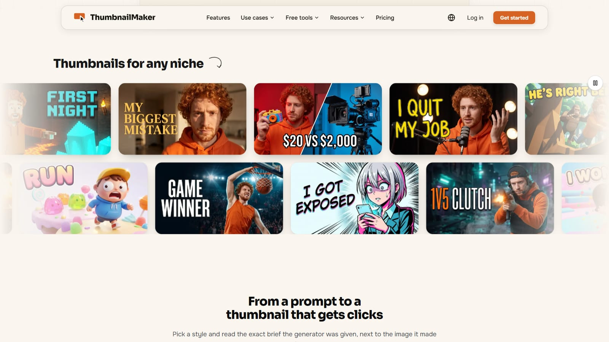

<p align="center">
  
</p>

<h1 align="center">ThumbnailMaker MCP server</h1>

<p align="center">
  YouTube thumbnails from your AI chat: briefs, checks, generation and edits, price shown first.
</p>

<p align="center">
  <a href="https://www.thumbnailmaker.so/mcp">Setup guide</a> ·
  <a href="https://www.thumbnailmaker.so/developers">Developer docs</a> ·
  <a href="https://registry.modelcontextprotocol.io/v0/servers?search=so.thumbnailmaker">Official MCP Registry</a> ·
  <a href="https://www.thumbnailmaker.so">Website</a>
</p>

---

[ThumbnailMaker](https://www.thumbnailmaker.so) turns a YouTube video link, or one sentence, into a finished thumbnail: 1280 × 720 for videos, 1080 × 1920 for Shorts. The words are drawn into the image, read back and fixed if a letter came out wrong, and the whole image is graded at the 336 px width the desktop feed shows it, with the corner where YouTube prints the video length kept clear.

This repository documents the hosted MCP server. There is nothing to install or run: your client connects to the URL below.



## Server

| | |
|---|---|
| URL | `https://www.thumbnailmaker.so/api/mcp` |
| Transport | Streamable HTTP |
| Sign-in | OAuth (dynamic client registration), or a ThumbnailMaker API key as a bearer token |
| No-account endpoint | `https://www.thumbnailmaker.so/api/mcp/free` (the three free tools) |
| Registry name | `so.thumbnailmaker/thumbnailmaker` |

A request without credentials gets a `401` whose `WWW-Authenticate` header points at `/.well-known/oauth-protected-resource`, so clients that speak MCP authorization start the login on their own.

## Connect

### ChatGPT

1. Open **Settings → Apps & Connectors → Advanced settings** and turn on **Developer mode**.
2. Go back to **Apps & Connectors** and click **Create**.
3. Name it **ThumbnailMaker**, paste `https://www.thumbnailmaker.so/api/mcp`, choose **OAuth**, then click **Create**.
4. Log in to ThumbnailMaker and click **Allow**.

In a chat, click **+**, pick ThumbnailMaker and ask for your thumbnail.

### Claude (web and desktop)

1. Open **Customize → Connectors**.
2. Click **Add → Add custom connector**.
3. Name it **ThumbnailMaker**, paste `https://www.thumbnailmaker.so/api/mcp`, then click **Add**.
4. Click **Connect**, log in to ThumbnailMaker and click **Allow**.

### Claude Code

```bash
claude mcp add --transport http thumbnailmaker https://www.thumbnailmaker.so/api/mcp
# then /mcp in Claude Code to log in, or send a key:
#   --header "Authorization: Bearer tm_your_key"
```

### Cursor, VS Code and other clients

```json
{
  "mcpServers": {
    "thumbnailmaker": {
      "url": "https://www.thumbnailmaker.so/api/mcp",
      "headers": { "Authorization": "Bearer tm_your_key" }
    }
  }
}
```

API keys are made in **Settings** on thumbnailmaker.so. The same file is in [`examples/mcp.json`](examples/mcp.json).

## Tools

**Free, no account** (also on `/api/mcp/free`):

| Tool | What it does |
|---|---|
| `write_thumbnail_brief` | The scene, two to four words and the style for a video, from its link or a sentence |
| `check_thumbnail` | Measures a video's current thumbnail: custom size, duration-badge corner, contrast |
| `thumbnail_specs` | YouTube's thumbnail sizes and file limits |

**Signed in:**

| Tool | What it does |
|---|---|
| `generate_thumbnail` | A thumbnail in 16:9 or a 9:16 Shorts cover, text drawn in and checked |
| `correct_thumbnail` | One change by instruction ("make the text bigger"), the original kept |
| `make_three_to_test` | Three concepts on three angles, for YouTube's own A/B test |
| `list_thumbnails`, `get_thumbnail` | Your Library |
| `list_brand_kits` | Your brand kits |
| `get_account` | Plan and thumbnails left |

The three tools that spend credits answer the first call with the price and a quote id, and run only when they are called again with that id after you agree. If an image fails, its credits come back on their own. Every image also lands in your Library on thumbnailmaker.so. Real people and celebrities are refused.

## Try it

- "Write the thumbnail brief for https://www.youtube.com/watch?v=... and tell me what you would put on it."
- "Make a thumbnail for my video about surviving 100 days in Minecraft hardcore, with the words 100 DAYS."
- "Check my current thumbnail: [video link]. Does the text read at feed size?"
- "Make three thumbnails to A/B test for [video link]."
- "Make a Shorts cover for my 30-second cooking hack, in the Shocked Reaction style."
- "Make the text bigger on my last thumbnail."

## Pricing

The brief, the check and the specs are free. Making and correcting images from a chat is part of the Studio plan ($99 a month, 300 thumbnails). A thumbnail is 10 credits, 4K or a second take counts double, three to test is 30, the same as in the web app. See [the plans](https://www.thumbnailmaker.so/pricing).

## Support

Write to [contact@thumbnailmaker.so](mailto:contact@thumbnailmaker.so), or open an issue here.

Claude is a trademark of Anthropic and ChatGPT a trademark of OpenAI; ThumbnailMaker is not affiliated with either.
